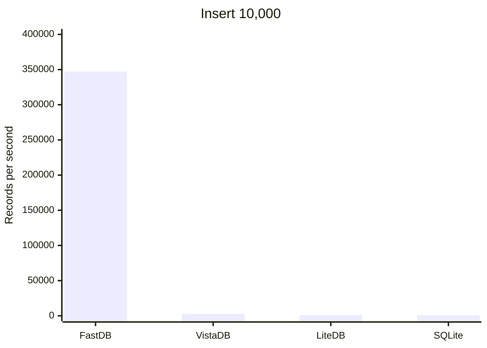
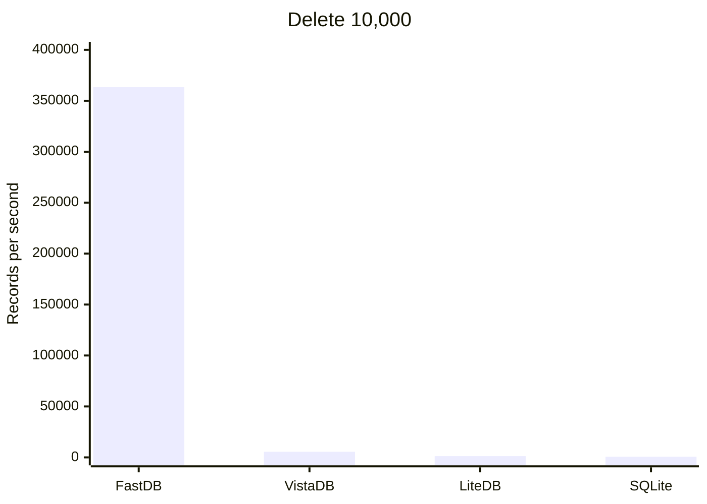
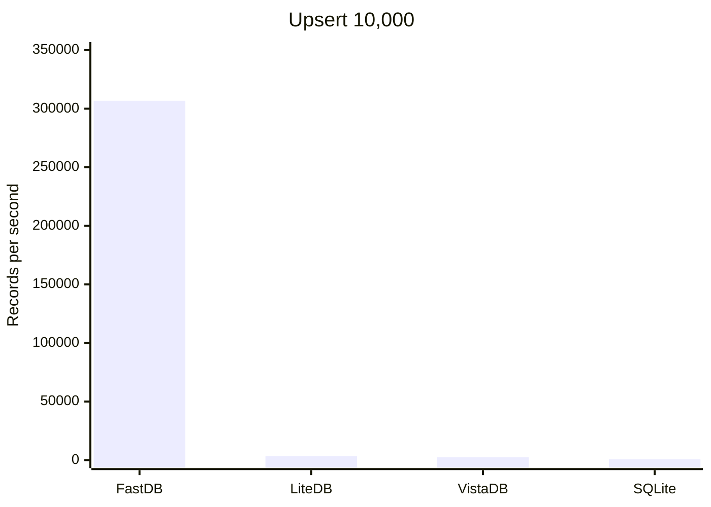
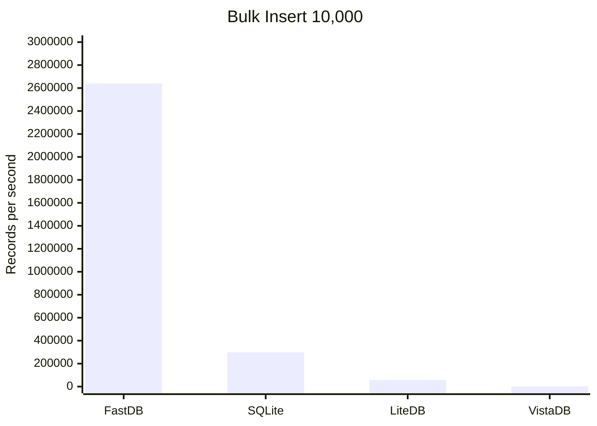
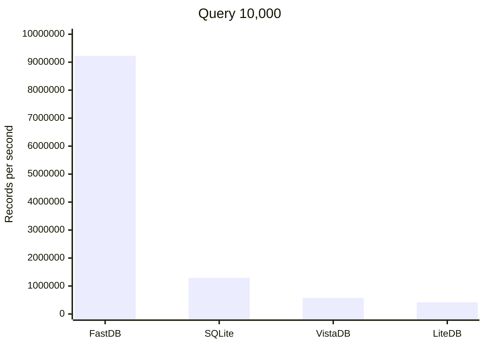

# Stellar.FastDB - High Performance Embedded Storage for C# (.NET)
Stellar.FastDB is an exceptionally fast document store for C# with speeds approximately 100x faster than similar products. Designed for optimal performance and high concurrency, it excels in embedded workflows that demand efficiency.

*Throughput (Records Per Second - Higher is Better)*











****

**Key Features**

- Serverless, embedded document storage.
- Simple, thread-safe API that closely resembles a .NET dictionary, with async/await support.
- Entirely written in C#, targeting .NET 8, 9 and 10.
- Delivered as a compact, single DLL (about 80 KB).
- Supports multiple concurrent readers and writers. Writers that arrive together share one disk write.
- Three durability modes: a write can return once it reaches the operating system (the default), once it is on disk, or immediately.
- Automatic background compaction reclaims space without stopping writes.
- Fast loading: records are decoded on all cores.
- Schema-less NoSQL storage that adapts to changes.
- Optimized storage footprint with configurable storage formats (JSON, MessagePack).
- LZ4 compression and AES encryption.
- Supports querying with LINQ.
- Ensures end-to-end type safety for data integrity.
- Accomodates composite keys for complex data structuring.
- Open source and free for both personal and commercial use.
- **Install from NuGet**. [Install-Package Stellar.FastDB](https://www.nuget.org/packages/Stellar.FastDB).

---
## TL;DR
It's essentially a ConcurrentDictionary with built-in persistence.

## Benchmarks

A detailed list of [benchmarks](https://github.com/stonstad/Stellar.Benchmarks/tree/main), along with a reproducible project, is available.

### FastDB 2.0

Measured on an AMD Ryzen 9 7950X with Windows 11 and .NET 10, using BenchmarkDotNet (1 warmup, 3 iterations).

 Method      | Op/s      | FileSize |
------------ |----------:|---------:|
 Insert 10,000 | 339,801 | 663 KB |
 Delete 10,000 | 357,801 | 0 KB |
 Upsert 10,000 | 318,033 | 614 KB |
 Bulk Insert 10,000 | 3,007,217 | 614 KB |
 Query 10,000 | 9,032,064 | 663 KB |

### Compared with other embedded databases

#### Insert
 Method      | Product | Op/s      | FileSize |
------------ |-------- |----------:|---------:|
 **Insert 10,000** | <ins>FastDB</ins>  | **347,343** | **663 KB** |
 Insert 10,000 | VistaDB |   2,648 |   940 KB |
 Insert 10,000 | LiteDB  |   1,110 | 1,656 KB |
 Insert 10,000 | SQLite  |     644 |   444 KB |

#### Delete
 Method      | Product | Op/s      | FileSize |
------------ |-------- |----------:|---------:|
 **Delete 10,000** | <ins>FastDB</ins>  | **363,406** | **0 KB** |
 Delete 10,000 | VistaDB |   5,503 |   940 KB |
 Delete 10,000 | LiteDB  |   1,179 | 1,664 KB |
 Delete 10,000 | SQLite  |     664 |   444 KB |

#### Upsert
 Method      | Product | Op/s      | FileSize |
------------ |-------- |----------:|---------:|
 **Upsert 10,000** | <ins>FastDB</ins>  | **306,743** | **614 KB** |
 Upsert 10,000 | LiteDB  |   3,256 | 1,664 KB |
 Upsert 10,000 | VistaDB |   2,372 |   940 KB |
 Upsert 10,000 | SQLite  |     648 |   444 KB |

#### Bulk Insert
 Method    | Product | Op/s      | FileSize |
---------- |-------- |----------:|---------:|
 **Bulk 10,000** | <ins>FastDB</ins>  | **2,640,357** |   **614 KB** |
 Bulk 10,000 | SQLite  | 298,523 |   444 KB |
 Bulk 10,000 | LiteDB  |  56,904 |     8 KB |
 Bulk 10,000 | VistaDB |   2,706 |   952 KB |

#### Query
 Method     | Product | Op/s         | FileSize |
----------- |-------- |-------------:|---------:|
 **Query 10,000** | <ins>FastDB</ins>  | **9,225,092** | **663 KB** |
 Query 10,000 | SQLite  |  1,291,256 |   444 KB |
 Query 10,000 | VistaDB |    574,299 |   940 KB |
 Query 10,000 | LiteDB  |    420,372 | 1,656 KB |

 ---

## Common Questions

**Why was Stellar.FastDB created?**

As a game developer, I need a high-concurrency storage solution for player-managed game servers. Requiring players to install local databases isn’t practical. However, most available storage options are either too slow or struggle with concurrent reads and writes. These limitations make them unsuitable for game servers, which require high volume reads and writes without performance issues.

**Should I use Stellar.FastDB?**

Use Stellar.FastDB if you need:
- Embedded, durable storage suitable for applications like game servers and desktop apps.
- Thread safety with robust support for high concurrency.
- High throughput for both reading and writing data.
- A minimal data storage footprint.

Do not use this database if you need:
- Sharing conections between processes.
- Storing data in a single file. Each collection is stored in its own file.

## How to use Stellar.FastDB
- Stellar.FastDB's APIs are designed to be intuitive and closely resemble .NET collections. If you are familiar with using a Dictionary, you'll find the transition to FastDB seamless!
- By default, a write returns once it has reached the operating system, so it survives a crash of your process. See [Durability](#durability) for the other modes.
- To get started with Stellar.FastDB, install it from NuGet. Search for '**Stellar.FastDB**' or use the package manager command ['Install-Package Stellar.FastDB'](https://www.nuget.org/packages/Stellar.FastDB).

## Durability

The `Durability` option decides when a write returns, and so which failures a write survives once it has returned. In every mode, a change is visible to reads as soon as it's made, and writers that arrive at the same time share one write to the file.

| Mode | A write returns once | Survives a process crash | Survives a power loss |
|---|---|:---:|:---:|
| `Flushed` (default) | it has reached the operating system | Yes | No |
| `Synced` | it has been flushed to disk | Yes | Yes |
| `Buffered` | it is queued in memory | No | No |

**Flushed** is the default. Each write is handed to the operating system before the call returns. If your process crashes, the operating system still writes the data to disk. If the machine loses power or the operating system crashes before it has done so, the most recent writes can be lost.

**Synced** also waits for the disk to confirm each write, so a write that has returned survives a power loss. It is the slowest mode for a single writer, because every write waits for the disk. When several threads write at once, they share each flush to disk.

**Buffered** returns as soon as a write is queued, and a background thread writes the queue to the file. It is the fastest mode, but writes still in the queue are lost if the process crashes. Call `Flush()` or `FlushAsync()` to wait until every earlier write has reached the operating system. `MaxBufferedBytes` (256 MB by default) limits the queue: when it is full, writes wait until it drains.

**When a write fails**, for example because the disk is full, the change stays in memory but isn't in the file. In `Flushed` and `Synced` modes, the call that made the change throws an `IOException`, or returns false if `StorageFailureBehavior` is `ReturnFalse`. In `Buffered` mode, the next `Flush()` throws it instead.

**After a crash**, nothing written before the crash is damaged. Every block in the file carries a checksum, and when the collection opens, a write that was cut off partway through is discarded.

```C#
FastDBOptions options = new FastDBOptions()
{
   Durability = DurabilityMode.Synced,
};
FastDB fastDB = new FastDB(options);
```

## Code Samples

### Getting Started

Below is a basic example demonstrating how to interact with Stellar.FastDB. This includes creating a database instance, storing customer data, updating it, retrieving it, and properly closing the database connection:

```C#
// create a class
public class Customer
{
    public int Id { get; set; }
    public string Name { get; set; }
    public DateTime DOB { get; set; }
    public string Phone { get; set; }
    public bool IsActive { get; set; }
}

// create database
FastDB fastDB = new FastDB();

// create a collection (key, value)
var customers = fastDB.GetCollection<int, Customer>();

// create your new customer instance
var customer = new Customer
{
   Id = 1,
   Name = "John Wick",
   Phone = "555-555-5555",
   DOB = new DateTime(2000, 1, 1),
   IsActive = true,
};

// add customer
customers.Add(customer.Id, customer);

// update customer
customer.Name = "John Wick's Dog";
customers.Update(customer.Id, customer);

// read customer
if (customers.TryGet(1, out Customer found))
    Console.WriteLine(found.Name);

// use LINQ to query
var matches = customers.Where(a => a.Name.StartsWith("John") && a.Phone != null);

// close database
fastDB.Close();
```

### Async
```C#
// each write can be awaited
await customers.AddAsync(customer.Id, customer);

// a bulk add writes all of its records together
await customers.AddBulkAsync(newCustomers.ToDictionary(a => a.Id, a => a));

await fastDB.CloseAsync();
```

### Encryption
```C#
FastDBOptions options = new FastDBOptions()
{
   IsEncryptionEnabled = true,
   EncryptionPassword = "open-sesame",
};
FastDB fastDB = new FastDB(options);
```

### Compression
Compression applies to the MessagePack serializers, which are the default.

```C#
FastDBOptions options = new FastDBOptions()
{
   IsCompressionEnabled = true,
};
FastDB fastDB = new FastDB(options);
```

### Compaction
Every update and removal leaves the old record behind in the file. Background compaction reclaims that space while you write, and finishes the job once writes pause for `CompactionIdleDelay` (250 ms by default). `CompactionEffort` sets how hard it works while writes are coming in: `Off`, `Low`, `Balanced`, `High` or `Maximum`. The default, `Balanced`, keeps a file at about twice the size of its live data under steady writing. `Off` turns background compaction off, and `Maximum` compacts as fast as possible.

```C#
FastDBOptions options = new FastDBOptions()
{
   CompactionEffort = CompactionEffort.Balanced,
};
FastDB fastDB = new FastDB(options);

// or compact everything now
fastDB.Compact();
```

### Large Records
Encryption and compression cost more as records grow. Buffered writes return without waiting for the disk, which recovers much of that cost.

```C#
FastDBOptions options = new FastDBOptions()
{
   Durability = DurabilityMode.Buffered,
   IsEncryptionEnabled = true,
   EncryptionPassword = "open-sesame",
   IsCompressionEnabled = true,
};
FastDB fastDB = new FastDB(options);
```

FastDB 2.0, 10,000 records of about 2 KB each:

|  Method                           | Op/s      | FileSize |
|--------------------------------- |----------:|---------:|
| Large                            | 173,090 | 20,106 KB |
| Large Encrypted                  | 123,968 | 20,214 KB |
| Large Encrypted Compressed       |  91,494 | 14,902 KB |
| Large Encrypted Compressed Buffered | 124,242 | 14,898 KB |

### Optional Serialization Contracts

To achieve the smallest possible storage footprint, Stellar.FastDB supports serialization contracts using MessagePack. By adding [MessagePack](https://github.com/MessagePack-CSharp/MessagePack-CSharp) attributes to your data models (as shown in the example below), you can instruct the serializer to package the data more efficiently. Note that this feature is disabled by default and is typically not included in most benchmarks.

```C#
// create a class
public class Customer
{
    [Key(0)]
    public int Id { get; set; }
    [Key(1)]
    public string Name { get; set; }
    [Key(2)]
    public DateTime DOB { get; set; }
    [Key(3)]
    public string Phone { get; set; }
    [Key(4)]
    public bool IsActive { get; set; }
}

FastDBOptions options = new FastDBOptions()
{
   Serializer = SerializerType.MessagePack_Contract,
};
FastDB fastDB = new FastDB(options);

// create a collection (key, value)
var customers = fastDB.GetCollection<int, Customer>();

// add customer
customers.Add(customer.Id, customer);

// close database
fastDB.Close();
```

FastDB 2.0, 10,000 records:

| Serializer | Op/s      | FileSize |
|--------- |----------:|---------:|
| Default 10,000  | 355,669 |   663 KB |
| Contract 10,000 | 349,656 |   379 KB |

## Options

Pass a `FastDBOptions` to `new FastDB(options)` to apply it to every collection, or to `GetCollection` to apply it to one collection. Options can't be changed after they're created. `Serializer`, `IsCompressionEnabled` and `IsEncryptionEnabled` take effect when a collection's file is created; an existing file keeps the settings it was created with.

**Where data is stored**

| Option | Default | Description |
|---|---|---|
| `BaseDirectory` | The current directory | The directory that holds the database's directory. |
| `DatabaseName` | `"Fast_DB"` | The name of the database's directory. `DirectoryPath` (read-only) combines the two. |
| `FileExtension` | `"db"` | The extension of each collection's file. |
| `GeneratedFileNameCreationFunction` | None | Changes the file name of a collection opened without a name, which is otherwise named after its value type. |
| `IsMemoryOnlyEnabled` | `false` | Keeps collections in memory only; nothing is written to disk. |
| `IsReadOnlyEnabled` | `false` | Opens collections read-only; writes throw. |

**Serialization**

| Option | Default | Description |
|---|---|---|
| `Serializer` | `MessagePack_Contractless` | `MessagePack_Contractless`, `MessagePack_Contract` (smallest files; needs `[Key]` attributes) or `SystemTextJson_JSON`. |
| `MessagePackOptions` | None | Custom MessagePack options, such as a resolver. |
| `JsonSerializerOptions` | None | Custom System.Text.Json options. By default, read-only properties are ignored. |

**Writing**

| Option | Default | Description |
|---|---|---|
| `Durability` | `Flushed` | When a write returns: `Flushed`, `Synced` or `Buffered`. See [Durability](#durability). |
| `MaxBufferedBytes` | 256 MB | In `Buffered` mode, how much data may wait to be written. When it's full, writes wait until it drains. |
| `ParallelBulkThreshold` | 1,000 | How many records a bulk add needs before its records are serialized on all cores. |
| `ParallelBulkChunkSize` | 250 | The fewest records each core serializes in such a bulk add. |

**Compaction**

| Option | Default | Description |
|---|---|---|
| `CompactionEffort` | `Balanced` | How hard background compaction works while writes are coming in: `Off`, `Low`, `Balanced`, `High` or `Maximum`. `Balanced` keeps a file at about twice the size of its live data under steady writing. `Off` turns background compaction off; `Compact()` still works. |
| `CompactionIdleDelay` | 250 ms | How long writes must pause before background compaction finishes regardless of effort, shrinking the file to about the size of its live data. |

**Loading**

| Option | Default | Description |
|---|---|---|
| `LoadBatchSize` | 4,096 | How many records are deserialized together when a collection opens. Batches are deserialized on all cores and applied in file order. |

**Encryption and compression**

| Option | Default | Description |
|---|---|---|
| `IsEncryptionEnabled` | `false` | Encrypts each record with AES. Requires `EncryptionPassword`. |
| `EncryptionPassword` | None | The password the encryption key is derived from. |
| `EncryptionAlgorithm` | `SHA256` | The hash algorithm used to derive the encryption key from the password. |
| `IsCompressionEnabled` | `false` | Compresses each record with LZ4. Applies to the MessagePack serializers only. |

**Error handling**

Each of these is `Exception` (the default) or `ReturnFalse`. The duplicate-key options can also be `Upsert`, which replaces the existing record.

| Option | Default | When it applies |
|---|---|---|
| `AddDuplicateKeyBehavior` | `Exception` | `Add` is given a key that already exists. |
| `BulkAddDuplicateKeyBehavior` | `Exception` | A bulk add is given a key that already exists. With `ReturnFalse`, nothing from the bulk add is added. |
| `UpdateKeyNotFoundBehavior` | `Exception` | `Update` is given a key that doesn't exist. |
| `RemoveKeyNotFoundBehavior` | `Exception` | `Remove` is given a key that doesn't exist. |
| `StorageFailureBehavior` | `Exception` | A write to the file fails. The change stays in memory. |
| `SerializationFailureBehavior` | `Exception` | A record can't be serialized. Nothing is changed. |
| `DeserializationFailureBehavior` | `Exception` | A record in the file can't be deserialized when a collection opens. With `ReturnFalse`, the record is skipped. |


## Contact

I may be contacted on the [Stellar Conquest Discord (stonstad)](https://discord.gg/uQsAeze) and [X (stonstad)](https://x.com/ShaunTonstad).
